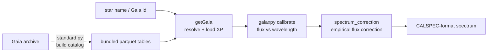

# gaiaspec

**gaiaspec** turns [Gaia](https://www.cosmos.esa.int/web/gaia) XP spectra into
**standard-star spectra** usable for atmospheric calibration of AuxTel (and other
instruments), in the same format as the
[CALSPEC](https://www.stsci.edu/hst/instrumentation/reference-data-for-calibration-and-tools/astronomical-catalogs/calspec)
reference standards.

It lets you:

- **retrieve** a Gaia XP spectrum for a star by name or Gaia DR3 source id, from
  a bundled local catalog or from the Gaia archive
  ([`getGaia`](api/getGaia.md));
- **calibrate** the XP coefficients into flux vs wavelength (via `gaiaxpy`) and
  wrap it in the CALSPEC dictionary format ([`getGaia`](api/getGaia.md));
- **flux-correct** the Gaia spectrum against a bundled table of Gaia/CALSPEC
  pairs, removing the smooth XP calibration residual
  ([`spectrum_correction`](api/spectrum_correction.md));
- **build** new standard-star catalogs from the Gaia archive around chosen sky
  fields, with quality-flag and spectral-type selection
  ([`standard`](api/standard.md)).

## Quick look

```python
from gaiaspec import getGaia

star = getGaia.Gaia("HD111980")          # resolve via Simbad -> Gaia DR3 id
spec = star.get_spectrum_numpy(flux_correction="m3")
wavelength = spec["WAVELENGTH"]          # astropy Quantity (nm)
flux       = spec["FLUX"]                # W m^-2 nm^-1
```

## How the pieces fit



## Next steps

- [Getting started](getting-started.md) — install and fetch a first spectrum.
- [How it works](pipeline.md) — from Gaia id to corrected CALSPEC spectrum.
- [API reference](api/index.md) — every module, class and function.
