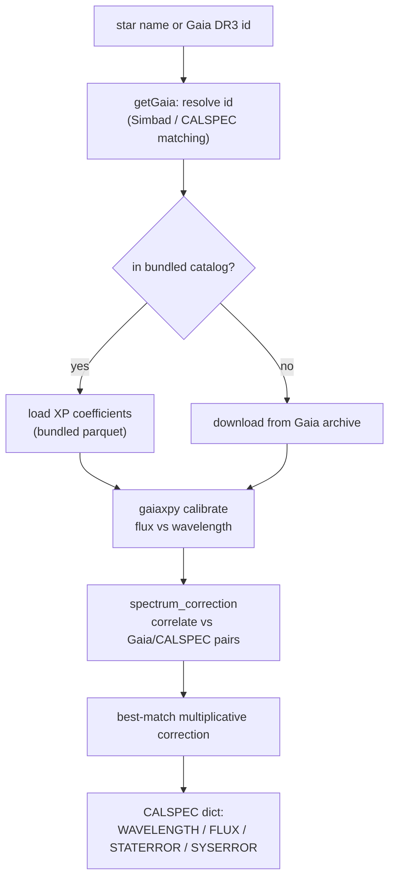

# How it works

gaiaspec produces a **CALSPEC-format standard spectrum** from a Gaia XP
spectrum, in two flavours: fetching an existing star, and building the reference
tables in the first place.

## Retrieving a spectrum ([`getGaia`](api/getGaia.md))

1. **Resolve** the star to a Gaia DR3 source id — from a star name via Simbad
   (`get_gaia_name_from_star_name`, cached locally), or from a CALSPEC label via
   the bundled matching table (`get_gaia_name_from_calspec`).
2. **Load** the XP coefficients: from the bundled `gaia_spectra_file.parquet` if
   the star is local, otherwise download them from the Gaia archive
   (`get_gaia_from_query_id`, cached under `.cache/gaiaxpy`).
3. **Calibrate** the coefficients into flux vs wavelength with `gaiaxpy`.
4. **Format** the result as a CALSPEC dictionary with astropy units
   (`convert_gaia_spectrum_to_calspec_format`).

The [`Gaia`](api/getGaia.md) class bundles steps 1–4 for a single star and adds
plotting.

## Flux correction ([`spectrum_correction`](api/spectrum_correction.md))

Gaia XP spectra carry a smooth flux-calibration residual. gaiaspec corrects it
empirically:

1. **Correlate** the target flux against a bundled table of Gaia spectra that
   have matching CALSPEC references (`compute_gaia_correlation`, or the
   vectorised `multi_pearsonr` for many spectra).
2. **Select** the best-correlated reference above a threshold
   (`find_best_gaia_correction`).
3. **Apply** its `corrected_flux / gaia_spectrum` ratio, interpolated onto the
   target wavelength grid (unity where no acceptable match exists).

## Building the reference tables ([`standard`](api/standard.md))

The bundled tables are produced by querying the Gaia DR3 archive:

1. **Query** non-variable, well-behaved sources with XP spectra inside RA/Dec
   boxes around chosen field centres, brighter than a magnitude limit.
2. **Filter** by Simbad spectral type if requested (`get_spType`), and by Gaia
   quality flags (`catalog_selection`: RUWE, colour-excess, processing mode,
   transit counts, ...).
3. **Download** the XP spectra in chunks (`chunks_data_split`,
   `create_standard_catalog`) and **write** the source / spectra parquet tables
   (`write_tables`).

## Conventions

- Wavelengths in **nm**, fluxes in **W m⁻² nm⁻¹** (astropy `Quantity`).
- A spectrum is a dict with keys `WAVELENGTH`, `FLUX`, `STATERROR`, `SYSERROR`
  — the CALSPEC convention, so gaiaspec spectra are drop-in standards.
